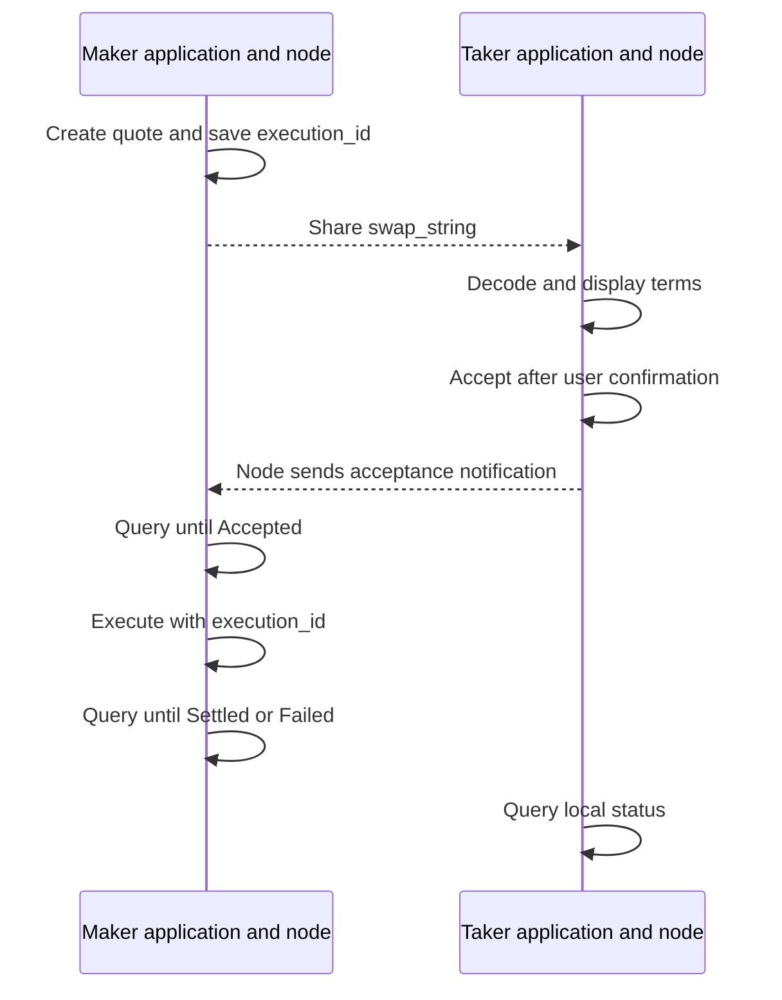

# Swap frontend integration guide

This guide describes the node behavior at commit
[`5c97e220`](https://github.com/bitlightlabs/rgb-ldk-node/commit/5c97e220489f81a5728121355ce1624fdc4d036e).
See [`source.json`](../generated/spec/source.json) for the source revision,
[OpenAPI](../generated/spec/openapi.json) for request and response definitions,
and [`examples/swap.ts`](../examples/swap.ts) for complete TypeScript examples.

A swap exchanges bitcoin for an RGB asset. The **maker** creates the quote and
starts the payment. The **taker** reviews and accepts the quote on a separate
node. The payment travels from the maker to the taker and then back to the maker,
with the asset exchange occurring at the taker.

Save the `execution_id` returned when the quote is created, together with the
node identity and the user's role. This identifier stays the same across payment
attempts and currently equals the 64-character hexadecimal `payment_hash`.
Use it to query, execute, and recover the swap. The `swap_string` carries the
quote between the parties for review and acceptance; execution and recovery no
longer require that original string.

Show the exchange as complete only when a status query returns
**`status === "Settled"`**. A successful execution request means that the node
handled the request, which may only have submitted the payment.

## 1. Set up the client and preserve numeric values

The packages in this repository have not been published to npm. Build them
locally and include the resulting packages in your application, or include both
packages in your application workspace:

```bash
pnpm install
pnpm build
pnpm typecheck:examples
```

```ts
import { RgbLdkNodeClient, HttpError } from "@bitlightlabs/rgbldk-node-client";
import { u64 } from "@bitlightlabs/rgbldk-node-api-types";

const maker = new RgbLdkNodeClient({
  baseUrl: "https://maker-node.example",
  token: { kind: "provider", getToken: () => getCurrentNodeToken() },
});
```

Use the same `RgbLdkNodeClient` for swaps and other node requests. Call
`getJson<Response>(path)`, `postJson<Request, Response>(path, body)`, or
`deleteJson<Response>(path)` with the generated types from
`@bitlightlabs/rgbldk-node-api-types`. These type arguments describe the request
and response; the client does not select them from the path or validate responses
against them at runtime.

In these examples, `baseUrl` is the server origin. Include `/api/v1` in every
request path; the generic client does not add that prefix.

`getCurrentNodeToken()` is a function supplied by your application. The client
uses the node's existing authentication. Browser access also depends on the
node's existing cross-origin access settings. If the browser cannot contact the
node directly, forward requests through your application server.

Create a separate client for the taker's node, using that node's address and
credentials. The taker must preview, accept, and query the swap on its own node.
Changing the page shown to the user does not change which node receives requests.

One bitcoin contains 100,000,000 satoshis. One millisatoshi is one thousandth of
a satoshi. Fields ending in `_msat` use millisatoshis. RGB quantities use the
asset's smallest unit; obtain the contract's precision before formatting them
for display.

| Data | Representation | Application handling |
| --- | --- | --- |
| `execution_id` and `payment_hash` | `string` | Preserve unchanged, along with the node identity and role. |
| 64-bit amounts, RGB quantities, `channel_scid`, plan `version`, and Unix timestamps in seconds | `U64String`, a decimal string | Use strings or `bigint` for calculations. Do not convert through `Number()`. |
| `base_fee_msat`, `fee_proportional_millionths`, expiry deltas in blocks, `expiry_secs`, and `format_version` | `number`, from unsigned 32-bit fields | Keep these as JSON numbers. The base fee is an exception to the decimal-string amount fields. |
| `asset_id` | `number[]` | These contract identifier bytes are different from the text required by `contract_id`. |
| `contract_id` | A string beginning with `contract:` | Use this text when creating a quote or querying contract information. |
| Absent output at the final channel, for example | `null` | Distinguish `null` from `"0"` and from a missing property. |

For example, `u64("9007199254740993")` preserves a channel identifier that exceeds
JavaScript's safe integer range. The helper rejects unsafe numeric input,
negative values, and values above `18446744073709551615`. Convert `bigint` values
to decimal strings before calling `JSON.stringify`.

Top-level quote amounts and channel identifiers require strings. Some nested
execution fields also accept numbers for compatibility, but frontend code should
consistently send decimal strings for all 64-bit values.

`btc_amount_msat` is the agreed bitcoin price. `btc_carrier_amount_msat` is the
bitcoin that accompanies an RGB transfer in its conditional Lightning payment.
This accompanying amount is called the **carrier** in the remaining examples.
Keep it separate from both the price and routing fees when displaying the quote.

## 2. Follow the request sequence on the correct nodes

All paths below start with `/api/v1`. The path parameter remains named
`{payment_hash}` in OpenAPI; pass the `execution_id` as its value.

| Caller | Request | Request body type | Response type |
| --- | --- | --- | --- |
| Maker | `POST /swap/offers` | `SwapCreateOfferRequest` | `SwapOfferResponse` |
| Maker | `POST /swap/offers/multihop` | `SwapCreateMultihopOfferRequest` | `SwapOfferResponse` |
| Taker | `POST /swap/decode` | `SwapStringRequest` | `SwapInfoDto` |
| Taker | `POST /swap/accept` | `SwapStringRequest` | `SwapInfoDto` |
| Maker | `POST /swap/execute` | `SwapExecuteRequest` | `SwapExecuteResponse` |
| Either party, on its own node | `GET /swap/{payment_hash}` | None | `SwapInfoDto` |
| Either party, on its own node | `GET /swap/list` | None | `SwapInfoDto[]` |
| Maker | `DELETE /swap/{payment_hash}` | None | `OkResponse` |

The two offer endpoints create quotes for a direct channel or an explicit route
through several channels. Decoding previews a quote without saving or accepting
it. Acceptance saves the quote and authorizes the taker to forward the payment.
Execution submits the payment or recovers an earlier attempt. Status and list
queries read local records; deletion is subject to the cancellation rules in
section 9.



The acceptance notification can be lost. A successful taker acceptance request
does not guarantee that the maker has received it. Normally, wait until the
maker's node reports `Accepted` before executing.

`force: true` bypasses only the check that the maker received the notification.
The taker still needs to accept, and the node still validates fees, routes,
capacity, and expiry requirements. Use this option only after independently
confirming that the taker accepted. Do not enable it as an automatic retry.

## 3. Create a quote and obtain confirmation

For a direct channel, replace the example public key, channel identifier, and
contract identifier with real values:

```json
{
  "counterparty_node_id": "<taker compressed public key>",
  "channel_scid": "123",
  "contract_id": "contract:...",
  "asset_amount": "100",
  "btc_amount_msat": "5000",
  "btc_carrier_amount_msat": "10000",
  "maker_gives_rgb": true,
  "expiry_secs": 3600
}
```

For a route through several channels, supply both directional **segments**. The
execution model calls each segment a `LegPlan`. A **hop** is one channel traversal
within a segment. Each route entry's `channel_scid` identifies the channel used
to reach that entry's `node_id`.

The first segment must end at the taker; the second must end at the maker. The
first channel in the return segment is the taker's authorized outbound channel.
It must remain the same even when the quote allows other route changes.

The following example routes both segments through a liquidity service provider,
a node that supplies channel liquidity. The field `required_lsps` specifies which
of these providers must appear in the route.

```json
{
  "maker_to_taker": [
    { "node_id": "<provider public key>", "channel_scid": "101" },
    { "node_id": "<taker public key>", "channel_scid": "102" }
  ],
  "taker_to_maker": [
    { "node_id": "<provider public key>", "channel_scid": "103" },
    { "node_id": "<maker public key>", "channel_scid": "104" }
  ],
  "contract_id": "contract:...",
  "asset_amount": "100",
  "btc_amount_msat": "5000",
  "btc_carrier_amount_msat": "10000",
  "maker_gives_rgb": true,
  "expiry_secs": 3600,
  "constraints": {
    "maker_to_taker": {
      "fixed_route": null,
      "required_nodes": ["<taker public key>"],
      "required_channels": [],
      "required_lsps": ["<provider public key>"],
      "max_fee_msat": "1000"
    },
    "taker_to_maker": {
      "fixed_route": null,
      "required_nodes": ["<maker public key>"],
      "required_channels": [],
      "required_lsps": ["<provider public key>"],
      "max_fee_msat": "1000"
    },
    "max_total_cltv_delta": 2016
  },
  "policy_hints": []
}
```

These endpoints do not find routes automatically. Your application or routing
service must supply connected nodes and usable channels. A list of provider
public keys alone does not describe a complete route.

| `maker_gives_rgb` | Asset on `maker_to_taker` | Asset on `taker_to_maker` |
| --- | --- | --- |
| `true` | RGB with its bitcoin carrier | Bitcoin |
| `false` | Bitcoin | RGB with its bitcoin carrier |

The field names always describe direction. Channels carrying RGB must support
the specified asset.

Set route constraints before presenting the quote for acceptance:

- **Omitting `constraints` fixes both original routes and sets both routing fee
  limits to zero.** Supply explicit constraints to allow fees or route changes.
- A route array in `fixed_route` fixes every node and channel. Set it to `null`
  to allow changes within the remaining constraints.
- `required_nodes` must appear in the stated order. Every `required_channels`
  and `required_lsps` entry must appear in its segment. Use `[]` when no such
  requirement applies.
- Each segment has its own `max_fee_msat`. The maker currently pays both segments'
  fees.
- `max_total_cltv_delta` limits the payment's expiry offset in blocks. The
  supported range is 192–2016; the route must also meet the per-channel expiry
  requirements described in section 6.

The quote binds the asset quantity, bitcoin price, carrier, asset direction,
validity period, fee limits, required routes, and settlement mode. The only
supported mode is `CircularHtlc`: a conditional payment that returns to the maker
after the exchange at the taker.

The creation response contains `execution_id`, `payment_hash`, `swap_string`,
and `info`. Share the string with the taker. Before accepting, send it to
`POST /api/v1/swap/decode` and display both node identities, the contract, the
quantity adjusted for asset precision, the bitcoin price, the carrier, who pays
each segment's fees, the fee limits, the required nodes and channels, and the quote expiry.
Obtain explicit user confirmation of these terms.

A successful preview does not reserve capacity. Channel policies and available
balances may change before execution, so the node validates the route again
when it builds the payment plan.

## 4. Execute and display progress

```ts
import type {
  SwapCreateMultihopOfferRequest,
  SwapExecuteRequest,
  SwapExecuteResponse,
  SwapInfoDto,
  SwapOfferResponse,
} from "@bitlightlabs/rgbldk-node-api-types";

const offer = await maker.postJson<SwapCreateMultihopOfferRequest, SwapOfferResponse>(
  "/api/v1/swap/offers/multihop",
  request,
);
saveSwap({ node: makerNodeId, executionId: offer.execution_id, role: "Maker" });

// Share offer.swap_string. The taker previews and accepts on its own node.
// Continue after the maker's node reports Accepted.
await maker.postJson<SwapExecuteRequest, SwapExecuteResponse>("/api/v1/swap/execute", {
  execution_id: offer.execution_id,
});

const current = await maker.getJson<SwapInfoDto>(
  `/api/v1/swap/${encodeURIComponent(offer.execution_id)}`,
);
renderSwap(current); // Show completion only when current.status === "Settled".
```

Here, `request` contains the quote fields described above. `makerNodeId`,
`saveSwap`, and `renderSwap` are supplied by your application. The complete
[TypeScript examples](../examples/swap.ts) expose these responsibilities through
function parameters.

The smallest execution request is:

```http
POST /api/v1/swap/execute
Content-Type: application/json

{ "execution_id": "<64 hexadecimal characters>" }
```

A typical response is:

```json
{
  "execution_id": "<64 hexadecimal characters>",
  "payment_hash": "<same identifier>",
  "ok": true,
  "status": "InFlight"
}
```

`ok: true` confirms that submission or recovery completed at the request level.
Recovery may instead return `Settled` if the payment already succeeded. If the
node cannot reread the record after a successful operation, its response may
contain only `{"ok":true}`. Always query the record to obtain its current status.

| `SwapInfoDto.status` | Meaning for the application | Next action |
| --- | --- | --- |
| `Offered` | Waiting for acceptance | Wait for the maker to receive the notification. Do not automatically enable `force`. |
| `Accepted` | Accepted; may be awaiting execution or recovering | Inspect the latest attempt before deciding whether to execute. |
| `InFlight` | Payment is in progress | Continue querying. Do not show the exchange as complete. |
| `Forwarded` | Forwarding is in progress in an older record | Continue querying. |
| `Settled` | Exchange completed | Refresh balances and finish the progress display. |
| `Failed` | Swap failed | Show `last_error` when present. A new transaction requires a new quote. |

Polling every one or two seconds is a reasonable starting point. Stop when the
page closes and increase the interval after network errors. A polling timeout
does not establish payment failure and does not justify canceling the record or
creating a replacement payment.

[`waitForOutcome`](../examples/swap.ts) demonstrates read-only polling with a
maximum number of requests. Its `AbortSignal` stops subsequent polls; it does
not cancel the payment or interrupt an already issued request.

Each party queries its own node, so the two status displays may update at
different times. Query the maker's node for sending plans and attempt history.
The taker's record need not contain the same attempts.

## 5. Inspect saved execution plans and fees

The `execution` property in a swap record contains the accepted quote, the
selected routes, and the plan history:

| Field | Meaning |
| --- | --- |
| `format_version` | The execution record's data format, currently `1`. Records with an unsupported value are rejected. |
| `quote` | The agreed amounts, fee limits, and route constraints. |
| `maker_to_taker` and `taker_to_maker` | The route entries of the selected plan for each direction. |
| `policy_hints` | Saved policies supplied for private channels. |
| `selected_plan` | The `version` of the plan whose routes are currently selected, as a decimal string. It is `null` until the first plan is calculated. |
| `plans[]` | Immutable plan history, in increasing `version` order. Replanning adds a plan without creating a send attempt. |
| `plans[i].version` | An increasing decimal-string version for the saved plan. It is not a count of payments sent. |
| `plans[i].format_version` | The plan's data format version, currently `1`. This is separate from the quote string's version prefix. |
| `plans[i].policy_snapshot_at_unix_secs` | When the channel policies used by the plan were recorded, as Unix seconds. |
| `plans[i].maker_to_taker` and `plans[i].taker_to_maker` | The complete `LegPlan` for each direction. |
| `attempts[]` | Send attempts in order, each referencing a saved plan version. |
| `attempts[i].plan_version` | The `plans[]` version that the attempt sent. |
| `attempts[i].status` | The attempt state: `Prepared`, `Submitted`, or `SendRejected`. |

Each `LegPlan` records its `direction`, `asset`, `fee_payer`, `constraints`, total
`fee_msat`, and `hops`. An asset is represented as either the string `"Btc"` or
an object containing the RGB asset identifier:

```ts
type LegAsset = "Btc" | { Rgb: { asset_id: number[] } };
```

Each hop records its source node (`source`), destination (`node_id`), channel
(`channel_scid`), actual bitcoin input and output (`btc_input_msat` and
`btc_output_msat`), RGB input and output (`rgb_input` and `rgb_output`), expiry
offsets (`incoming_cltv_delta` and `outgoing_cltv_delta`), and full channel
`policy`. The final hop ends at the maker, so its output fields are `null`.

The exchange occurs at the last hop of the first segment. The change in bitcoin
there includes the agreed price. Adding every hop's input-output difference
would therefore confuse the exchange price with routing fees. Display each
segment's `fee_msat` instead. If `selected_plan` is `null`, display the quote's
fee limits; no actual execution fee has been calculated yet.

The [complete response examples](../tests/fixtures/swap-executions.json) contain
plans built and validated by the recorded upstream implementation. The surrounding
contract and node details are test values, so these examples cannot be sent to
live nodes.

In these examples, the price is 5,000 millisatoshis and the carrier is 10,000
millisatoshis. Each forwarding policy charges a base fee of 100 millisatoshis
plus a proportional fee of 1,000 parts per million. All amounts below are
millisatoshis:

| Asset supplied by maker | Maker sends | Taker receives → sends | Maker receives | First segment fee + return segment fee |
| --- | --- | --- | --- | --- |
| RGB | 10,110 | 10,000 → 15,000 | 14,886 | 110 + 114 |
| Bitcoin | 15,115 | 15,000 → 10,000 | 9,891 | 115 + 109 |

The taker's bitcoin difference is exactly the quoted 5,000 millisatoshis. The
maker pays both routing fees; the return fee is deducted from the maker's final
receipt. After fees, a payment carrying RGB must still contain at least 1,000
millisatoshis. If the carrier is insufficient, obtain a new quote with a suitable
amount. Do not adjust accepted amounts locally: the node checks the actual
payment amounts against the accepted terms.

## 6. Supply private channel policies and understand expiry limits

A channel policy describes forwarding fees, amount limits, and the required
expiry interval for one direction of a channel. The node first uses local
channel information and channel announcements received from other nodes.

For a remote private channel absent from those announcements, provide its real
policy in `policy_hints` when creating or replacing a route. Each array entry
has this form:

```json
{
  "asset_id": null,
  "source": "<source node public key>",
  "destination": "<destination node public key>",
  "channel_scid": "103",
  "base_fee_msat": 100,
  "fee_proportional_millionths": 1000,
  "cltv_expiry_delta": 72,
  "htlc_minimum_msat": "1",
  "htlc_maximum_msat": "1000000",
  "rgb_htlc_maximum": null,
  "enabled": true,
  "provenance": "private-channel-provider",
  "last_update": null
}
```

This example describes a bitcoin channel. For an RGB channel, use the contract's
byte array for `asset_id` and its actual asset limit as a decimal string for
`rgb_htlc_maximum`. Include `rgb_htlc_maximum` even when its value is `null`.

The `htlc_*` fields describe limits for a hash and time locked contract, the
conditional payment used by Lightning. `cltv_expiry_delta` is the channel's
required expiry interval, measured in blocks. Fees and limits must match the
specified direction. Values copied from the reverse direction or arbitrary
nonzero fees cannot substitute for the real policy. Supplied hints cannot
override policies already known through local channels or shared announcements.

The node computes expiry offsets for the whole path. The final offset is 144
blocks. Each preceding hop must leave at least
`max(outgoing channel policy delta, 48)` more blocks, while the total stays within
the quote's limit. The complete examples use `360 → 288 → 216 → 144` blocks.
This spacing gives an upstream node time to claim its payment after the
downstream node claims. The frontend supplies routes and policies; the node
builds and validates the resulting `HopPlan` values.

## 7. Replace a route within the accepted terms

To use a different route, execute with the same identifier and supply both
replacement segments:

```ts
await maker.postJson<SwapExecuteRequest, SwapExecuteResponse>("/api/v1/swap/execute", {
  execution_id: executionId,
  maker_to_taker: replacementFirstLeg,
  taker_to_maker: replacementReturnLeg,
  policy_hints: replacementPrivatePolicies,
});
```

The replacement variables are arrays supplied by your application's routing
service. They use the same route and policy formats as the creation request.

The node saves a new plan version that meets the quote's constraints, selects
it, and saves a `Prepared` attempt referencing that version before submitting
the payment. One request can therefore save more than one plan version.
Replanning alone adds a plan without creating an attempt. There is no separate
endpoint that only replaces the route without attempting execution. If
replacement succeeds but sending fails, the saved version remains. Query the
record after an error to display the current route.

Both segments are required. A request cannot replace only one segment, update
only policy hints, or combine `swap_string` with an execution identifier or
replacement routes. The generated `SwapExecuteRequest` describes individual
fields; the node validates these combinations. It also checks fixed routes,
required nodes, providers and channels, fee limits, and the taker's authorized
first return channel.

Changing the price, asset quantity, carrier, asset direction, fee limits,
required route constraints, or settlement mode requires a new quote and fresh
taker acceptance. The new quote receives a new execution identifier. Pass quote
strings unchanged; do not rewrite them or add changed terms to an execution
request.

## 8. Recover after a connection loss or restart

The swap's overall `status` and each `attempt.status` describe different things.
Read both before deciding what action is available:

| Attempt status | Meaning | Application behavior |
| --- | --- | --- |
| `Prepared` | The attempt was saved before sending. The payment engine may already have accepted it if the process stopped before saving the next state. | Show that the result needs checking. Do not replace the route, cancel, or create a replacement payment. |
| `Submitted` | Submission was recorded, or recovered from payment records. | Continue checking the overall status; this attempt state alone does not prove completion. |
| `SendRejected` | The send was explicitly rejected. | Inspect the latest record and error. Correct the cause before a deliberate retry within the accepted terms. |

After the application reconnects or the node restarts:

1. Load the saved node identity and execution identifier, then query
   `GET /api/v1/swap/{payment_hash}`. If the application's saved list is missing,
   call `getJson<SwapInfoDto[]>("/api/v1/swap/list")` on the node's client.
2. If the swap is `Settled` or `Failed`, display that final result without
   executing it again.
3. If the latest attempt is `Prepared` or `Submitted`, explicitly send
   `POST /api/v1/swap/execute` once on the maker's node with
   `{ "execution_id": "<saved identifier>" }`, without replacement routes, then
   query again. Keep this recovery action outside the automatic polling loop.
4. During recovery, the node checks saved successful payment results as well as
   the Lightning payment engine's recent records. A confirmed success can move
   the swap to `Settled`; a pending payment remains `InFlight`. If the result is
   unknown, the node returns an error, keeps the record, and blocks a duplicate
   send.
5. While the result remains unknown, continue showing that it needs checking.
   Retain the identifier, latest status, plan version, and error for diagnosis.

`Accepted` with a `Prepared` attempt is a possible state after a crash. It does
not prove that no payment was sent. Successful payment notifications can finish
such attempts directly. If saving the result fails, the node retries processing
the notification. Recovery uses the saved execution identifier and does not
require the original `swap_string`.

## 9. Handle errors and cancellation

`HttpError` contains the response `status`, parsed `body: unknown`, and `rawBody`.
Node errors usually include `error` and `message`, but invalid requests and
application server errors may have different response formats. Check the body
before reading those properties. The example [`nodeErrorCode`](../examples/swap.ts)
shows how to do this.

Network errors retain their original `fetch` error type. The client does not
automatically retry transaction requests. After an execution error, query the
same identifier to learn whether the payment was submitted:

```ts
try {
  await maker.postJson<SwapExecuteRequest, SwapExecuteResponse>("/api/v1/swap/execute", {
    execution_id: executionId,
  });
} catch (error) {
  if (error instanceof HttpError) {
    showRequestError(error.status, error.body);
  } else {
    showConnectionLost();
  }

  // A failed request can still have submitted the payment.
  // If this query also fails, retain the pending display and query again later.
  const current = await maker.getJson<SwapInfoDto>(
    `/api/v1/swap/${encodeURIComponent(executionId)}`,
  );
  renderSwap(current);
}
```

The display functions are supplied by your application. Handle a failed status
query without creating a replacement swap.

| Error or response | Suggested action |
| --- | --- |
| `SwapNotAcceptedYet` | Wait for the maker's `Accepted` status. Do not automatically enable `force`. |
| `SwapCounterpartyOffline` | Check the other node's connection and channel readiness. |
| `SwapInsufficientCapacity` | Check the maker's outbound channel capacity. |
| `SwapInsufficientCounterpartyCapacity` | The taker cannot forward the quoted bitcoin amount. Check its bitcoin capacity; this does not establish a shortage of RGB units. |
| `SwapInvalidRoute` | Check route direction, RGB support, policies, fees, carrier, constraints, and expiry intervals. |
| `PaymentSendingFailed` | The send may have been rejected or its outcome may be unknown. Query the record and inspect the latest attempt. |
| `PersistenceFailed` | Keep the identifier and query or recover. A failed save does not prove that resending is safe. |
| `InvalidPaymentHash` or `InvalidAmount` | Check the identifier, state, quote validity period, and terms. These codes cover several validation failures. |
| Status query returns 404 | Check the node identity, identifier, and whether the record was deleted locally. Do not automatically create another transaction. |

Cancellation deletes the maker's local record. It does not notify the taker,
withdraw a conditional payment, or issue a refund. It is available only for
`Offered` or `Accepted` records without an unresolved `Prepared` or `Submitted`
attempt. The taker cannot use this endpoint to revoke acceptance. An active
payment cannot be cleared by deleting its record.

When cancellation is allowed, use the common client's deletion method:

```ts
import type { OkResponse } from "@bitlightlabs/rgbldk-node-api-types";

await maker.deleteJson<OkResponse>(`/api/v1/swap/${encodeURIComponent(executionId)}`);
```

## 10. Migrate existing integrations

The client package no longer exports `SwapClient` or `SwapExecuteOptions`.
Replace `new SwapClient(options)` with `new RgbLdkNodeClient(options)`, using the
same server origin and credentials. Replace its endpoint methods with
`getJson`, `postJson`, and `deleteJson`, using the paths and generated types in
section 2. Include `/api/v1` in each path and use `encodeURIComponent` for the
execution identifier in a path.

For execution, pass a `SwapExecuteRequest` body containing `execution_id` and
any replacement routes directly to `postJson`. The request format and node
behavior are unchanged. Route replacements still require both segments; the
server enforces that requirement. The [complete examples](../examples/swap.ts)
show creation, acceptance, execution, polling, and recovery with the common client.

| Previous usage | Current usage |
| --- | --- |
| `rgb_path` and `btc_path` | Use `maker_to_taker` and `taker_to_maker`. The old names remain input aliases only. |
| Keep the original string to execute a route through several channels | Save and use `execution_id`. |
| Send `payment_hash` in the execution request | Send `execution_id`. The old name remains an input alias. |
| Treat `ok: true` as completion | Query until `status === "Settled"`. |
| Read only the selected route | Inspect `execution.plans[]` and use `execution.selected_plan` to find the current one. |
| Convert channel identifiers and amounts to JavaScript numbers | Preserve decimal strings and use `bigint` for calculations. |

Do not send both an old alias and its replacement in one request; the node
rejects duplicate fields. Responses retain `payment_hash` for existing readers.
Generated TypeScript and Rust request types use the new names.

New direct-channel quote strings start with `rgb-swap:v1:`. New quotes for routes
through several channels start with `rgb-swap:v3:` and require complete quote
terms. The older `v2` format contains no quote object, fixes the route, and allows
zero routing fees. A `v2` string containing a quote object is rejected. Pass
strings unchanged between nodes; changing a prefix does not convert a quote.
Coordinate deployments so that both nodes support the required format.

Older saved swaps without complete route and execution data require a new quote
and acceptance. `SwapInfoDto.execution` is optional because older records and
some preview responses may omit it.

Package versions and `/api/v1` did not change with this feature. Use the recorded
upstream commit when coordinating deployment; those version numbers alone do
not establish support for the new flow.

The source update also changes liquidity service configuration:
`max_fulfill_retries` is replaced by `onchain_open_timeout_blocks`, which defaults
to 144. Update forms that manage this configuration. For orders paid on chain,
this field limits how many blocks the service retries opening a channel before
refunding. It is separate from swap fees and payment expiry.

Generated TypeScript now includes `null` where the node sends it and uses the
actual hyphen-separated RGB funding values, such as `"single-rgb-anchor"`.
Existing callers may need additional null checks or updated value comparisons.
These type corrections reflect the node's existing serialization. The `u64()`
helper also rejects unsafe numeric input; supply the original decimal string
or a `bigint` value instead.

## 11. Regenerate definitions and run checks

`scripts/rgbldk_api_sync.py` reads the node's request and response definitions,
then copies the serializable `application::swap_plan` types and decimal-value
serialization functions from the same commit. The resulting Rust definitions
do not depend on internal node packages or include payment planning logic.

The node's OpenAPI export describes policies, constraints, and execution records
as generic objects. Synchronization adds their full field definitions and records
this addition in `source.json.schema_enrichments`. Other endpoint and schema
definitions come from the upstream export. Change the source or generator and
regenerate the output; generated type files are overwritten during this process.

```bash
python3 scripts/rgbldk_api_sync.py sync --node-repo /path/to/rgb-ldk-node
pnpm gen
pnpm test:codegen
pnpm test
pnpm typecheck
pnpm typecheck:examples
cargo test --workspace
```

Tests check that complete upstream plans survive JSON serialization and parsing
without changes. They cover both asset directions, large channel identifiers,
null outputs, asset representations, legacy input aliases, request paths,
authentication, and request failures without automatic resending. Client tests
use simulated responses. Live Lightning and on-chain payment behavior is tested
in the upstream node repository.
